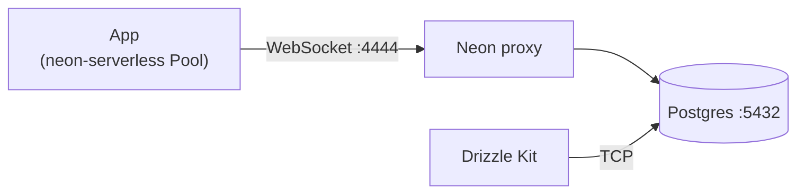

# README

SvelteKit app with TypeScript, Tailwind, Drizzle (Neon), Better Auth, and the Vercel adapter.

## Requirements

- [Bun](https://bun.sh) 1.4+ (see `packageManager` in `package.json`)
- [Docker](https://www.docker.com/) for local Postgres and the Neon proxy

## Setup

```sh
bun install
cp .env.example .env
bun auth:secret --write
bunx playwright install chromium
bun dev:up
bun db:push
```

## Database

Local dev uses the same Neon serverless stack as production: Postgres and the [Neon proxy](https://neon.com/guides/local-development-with-neon) in Docker. The app connects with `@neondatabase/serverless` **Pool** and `drizzle-orm/neon-serverless`.



Local `DATABASE_URL` must use host `db.localtest.me` (see `.env.example`). If you work offline or wildcard `*.localtest.me` does not resolve, add:

```
127.0.0.1 db.localtest.me
```

Drizzle Kit (schema and Studio):

```sh
bun db:push       # apply schema
bun db:generate   # generate migrations
bun db:migrate    # run migrations
bun db:studio     # Drizzle Studio (uses devDependency `pg`, not the proxy)
bun auth:schema   # Run after changing `src/lib/server/auth.ts`; then `db:push` again
```

## Git hooks

[Husky](https://github.com/typicode/husky):

- **pre-commit:** `lint-staged`, then `bun check`
- **pre-push:** `lint` → `check` → `build` → `test` (see [`.husky/pre-push`](.husky/pre-push))
- **commit-msg:** `commitlint` (conventional commits)

## CI

GitHub Actions ([`.github/workflows/ci.yml`](.github/workflows/ci.yml)) mirrors pre-push (plus Playwright in CI).

## Commands

| Task                       | Command           |
| -------------------------- | ----------------- |
| Dev server                 | `bun dev`         |
| Dev + open browser         | `bun dev --open`  |
| Production build           | `bun run build`   |
| Preview production build   | `bun preview`     |
| Typecheck                  | `bun check`       |
| Lint                       | `bun lint`        |
| Lint + format (fix)        | `bun lint:fix`    |
| Tests                      | `bun run test`    |
| Drizzle push               | `bun db:push`     |
| Better Auth Drizzle schema | `bun auth:schema` |
| Local DB (Docker)          | `bun dev:up`      |
| Stop local DB              | `bun dev:down`    |

## Scaffold reference

This matches how this repo was generated (see `bunx sv create --help` for add-on syntax).

```sh
bunx sv@1.3.0 create --template minimal --types ts \
  --add prettier eslint \
    'vitest="usages:unit,component"' tailwindcss="plugins:none" \
    sveltekit-adapter="adapter:vercel" \
    drizzle="database:postgresql+client:neon" \
    better-auth="demo:password" \
    'ai-tools="ide:cursor+tools:mcp,svelte-code-writer,svelte-core-bestpractices,svelte-file-editor+mcpSetup:remote+optInSkills:none"' \
  --install bun .
```

More: `sv` [CLI](https://github.com/sveltejs/cli) (`bunx sv add …`).
