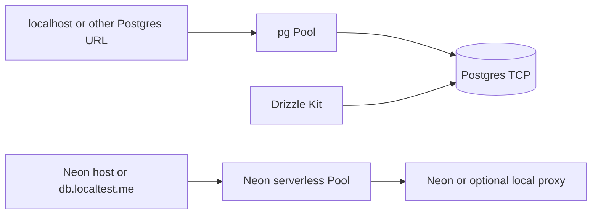

# Engineering

> **M#** = engineering milestone. Shipped: [`CHANGELOG.md`](../CHANGELOG.md). Active work: [`roadmap.md` — Now](roadmap.md#now).

What this repo is: [`README.md`](../README.md). Setup, commands, hooks, and CI live there.

## Stack

- **App:** Svelte 5 (runes), SvelteKit, TypeScript, Tailwind CSS 4, Vite
- **Database:** PostgreSQL 16+ locally, any hosted Postgres URL in production. Drizzle ORM. `localhost` and other ordinary hosts use `pg` (`drizzle-orm/node-postgres`). A `*.neon.tech` host and the optional `db.localtest.me` proxy use `@neondatabase/serverless` **Pool** (`drizzle-orm/neon-serverless`)
- **Auth:** [Better Auth](https://www.better-auth.com/) with the Drizzle adapter (email and password today; add `socialProviders` for Google, Apple, etc.). Credential sign-in requires a verified email
- **Email:** [Resend](https://resend.com/) in production. [Mailpit](https://mailpit.axllent.org/) over SMTP is an optional local inbox
- **Deploy:** `@sveltejs/adapter-vercel`. [`vercel.json`](../vercel.json) deploys the `main` branch only
- **Tooling:** pnpm, Node 22+, ESLint (simple-import-sort), Prettier, Vitest, Husky, lint-staged, commitlint. `npm install` also works
- **CI:** GitHub Actions — `pnpm lint`, `pnpm check`, `pnpm run build`, `pnpm test` ([`.github/workflows/ci.yml`](../.github/workflows/ci.yml))

`pnpm check` is typecheck only (`svelte-check`). Lint and Prettier check are `pnpm lint`.

## Layout

| Path                     | Role                                                                                                 |
| ------------------------ | ---------------------------------------------------------------------------------------------------- |
| `src/routes/`            | SvelteKit routes. `+layout.svelte`, `/`, and the Better Auth demo under `demo/better-auth/`          |
| `src/lib/`               | Shared modules safe to import from the client. Alias `#lib`                                          |
| `src/lib/server/`        | Server-only modules                                                                                  |
| `src/lib/server/auth.ts` | Better Auth instance (`APP_URL`, `BETTER_AUTH_SECRET`, Drizzle adapter, verification and reset mail) |
| `src/lib/server/email/`  | `sendEmail`, templates, and Resend vs SMTP choice                                                    |
| `src/lib/server/db/`     | Drizzle client, driver choice, Neon websocket config, app schema and generated auth schema           |
| `src/hooks.server.ts`    | Loads the session and sets `event.locals.user` / `event.locals.session`                              |
| `src/app.d.ts`           | `App.Locals` for that user and session                                                               |
| `src/env.ts`             | Private env (`DATABASE_URL`, `APP_URL`, `BETTER_AUTH_SECRET`, `EMAIL_FROM`, Resend, SMTP)            |
| `compose.yaml`           | Optional Postgres, Neon proxy (`4444`), and Mailpit (`1025` SMTP, `8025` UI)                         |
| `drizzle.config.ts`      | Drizzle Kit. Connects with TCP using `DATABASE_URL`                                                  |
| `vite.config.ts`         | Tailwind, SvelteKit, Vercel adapter, Vitest (Node)                                                   |
| `docker/neon-proxy/`     | Optional local Neon proxy image                                                                      |

Route files keep SvelteKit names (`+page.svelte`, `+layout.server.ts`). Other source files use lowercase kebab-case — [`.cursor/rules/conventions.mdc`](../.cursor/rules/conventions.mdc).

## Database

The default local URL uses `pg` over TCP, including `localhost` and `127.0.0.1`. Postgres 16 or newer is enough, and it has to be running. Drizzle Kit uses that same TCP URL. `pnpm db:push` checks the connection first and prints the database error when it cannot connect. Drizzle Kit's own progress view exits without that error.

A host ending in `.neon.tech` uses the Neon serverless **Pool** (`drizzle-orm/neon-serverless`) so `db.transaction()` works in production. `neon-http` cannot run interactive transactions in Drizzle. The optional Compose stack publishes Postgres on `5432` and the [Neon proxy](https://neon.com/guides/local-development-with-neon) on `4444`. With host `db.localtest.me`, the app uses that proxy and Drizzle Kit still uses TCP on `5432`.

[`src/lib/server/db/index.ts`](../src/lib/server/db/index.ts) builds the client. [`src/lib/server/db/driver.ts`](../src/lib/server/db/driver.ts) chooses the driver from the hostname. [`src/lib/server/db/neon-config.ts`](../src/lib/server/db/neon-config.ts) sends the Neon Pool through the local proxy when the host is `db.localtest.me` (WebSocket `:4444`).

Commands: [`README.md` — Database](../README.md#database).

Schema lives in [`src/lib/server/db/schema.ts`](../src/lib/server/db/schema.ts), which re-exports [`auth.schema.ts`](../src/lib/server/db/auth.schema.ts). After changing [`src/lib/server/auth.ts`](../src/lib/server/auth.ts), run `pnpm auth:schema`, then `pnpm db:push`.

## Auth

Better Auth is configured in [`src/lib/server/auth.ts`](../src/lib/server/auth.ts). [`src/hooks.server.ts`](../src/hooks.server.ts) attaches the session to `locals`. `APP_URL` must match the origin in the browser (cookies and CSRF). Generate `BETTER_AUTH_SECRET` with `pnpm auth:secret --write`. Names and comments: [`.env.example`](../.env.example). Leave `.env` unread unless the user asks.

Email and password sign-in requires a verified address (`emailAndPassword.requireEmailVerification`). That gate does not apply to social sign-in; each OAuth provider can opt in to its own `requireEmailVerification` later. Sign-up, an unverified credential sign-in, password reset, and a repeat sign-up for an existing address all call [`sendEmail`](../src/lib/server/email/send-email.ts) without awaiting it. That function passes the send to `waitUntil` from `@vercel/functions` so the Vercel function stays alive until delivery finishes. `RESEND_API_KEY` selects Resend; otherwise `SMTP_HOST` selects SMTP. With neither set, `sendEmail` prints the verification or reset link in the server log. Optional Mailpit is `localhost:1025`. The demo pages under `demo/better-auth/` are the verification and reset UI. Local inbox: [README.md — Email](../README.md#email).

## Tests

`pnpm test` runs Vitest in Node. It does not need Postgres, Mailpit, or a browser.
