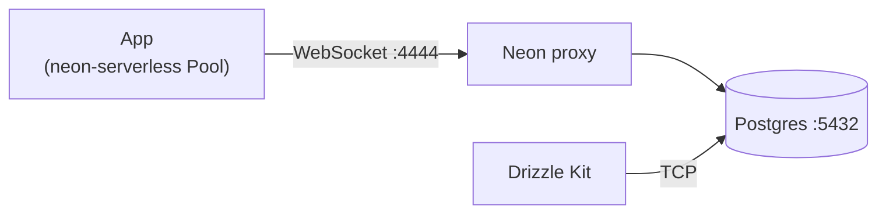

# Engineering

> **M#** = engineering milestone. Shipped: [`CHANGELOG.md`](../CHANGELOG.md). Active work: [`roadmap.md` — Now](roadmap.md#now).

What this repo is: [`README.md`](../README.md). Setup, commands, hooks, and CI live there.

## Stack

- **App:** Svelte 5 (runes), SvelteKit, TypeScript, Tailwind CSS 4, Vite
- **Database:** PostgreSQL 18 in Docker locally, [Neon](https://neon.tech/) in production; Drizzle ORM; `@neondatabase/serverless` **Pool** (`drizzle-orm/neon-serverless`)
- **Auth:** [Better Auth](https://www.better-auth.com/) (email and password) with the Drizzle adapter
- **Deploy:** `@sveltejs/adapter-vercel`. [`vercel.json`](../vercel.json) deploys the `main` branch only
- **Tooling:** Bun, ESLint (simple-import-sort), Prettier, Vitest, Playwright (component tests), Husky, lint-staged, commitlint
- **CI:** GitHub Actions — `bun lint`, `bun check`, `bun run build`, `bun run test` ([`.github/workflows/ci.yml`](../.github/workflows/ci.yml))

`bun check` is typecheck only (`svelte-check`). Lint and Prettier check are `bun lint`.

## Layout

| Path                     | Role                                                                                        |
| ------------------------ | ------------------------------------------------------------------------------------------- |
| `src/routes/`            | SvelteKit routes. `+layout.svelte`, `/`, and the Better Auth demo under `demo/better-auth/` |
| `src/lib/`               | Shared modules safe to import from the client. Alias `#lib`                                 |
| `src/lib/server/`        | Server-only modules                                                                         |
| `src/lib/server/auth.ts` | Better Auth instance (`APP_URL`, `BETTER_AUTH_SECRET`, Drizzle adapter)                     |
| `src/lib/server/db/`     | Drizzle client, Neon websocket config, app schema and generated auth schema                 |
| `src/hooks.server.ts`    | Loads the session and sets `event.locals.user` / `event.locals.session`                     |
| `src/app.d.ts`           | `App.Locals` for that user and session                                                      |
| `src/env.ts`             | Private env declarations (`DATABASE_URL`, `APP_URL`, `BETTER_AUTH_SECRET`)                  |
| `compose.yaml`           | Postgres 18 and the Neon proxy (`4444`)                                                     |
| `drizzle.config.ts`      | Drizzle Kit. Connects with TCP using `DATABASE_URL`                                         |
| `vite.config.ts`         | Tailwind, SvelteKit, Vercel adapter, Vitest (browser + node)                                |
| `docker/neon-proxy/`     | Local Neon proxy image                                                                      |

Route files keep SvelteKit names (`+page.svelte`, `+layout.server.ts`). Other source files use lowercase kebab-case — [`.cursor/rules/conventions.mdc`](../.cursor/rules/conventions.mdc).

## Database

Local dev uses the same Neon serverless driver as production. Postgres and the [Neon proxy](https://neon.com/guides/local-development-with-neon) run in Docker (`bun dev:up`). The app connects with a **Pool** so `db.transaction()` works. `neon-http` cannot run interactive transactions in Drizzle.

[`src/lib/server/db/index.ts`](../src/lib/server/db/index.ts) builds the Pool. [`src/lib/server/db/neon-config.ts`](../src/lib/server/db/neon-config.ts) sends that Pool through the local proxy when `DATABASE_URL` uses host `db.localtest.me` (WebSocket `:4444`). A `localhost` or `127.0.0.1` URL throws. Drizzle Kit and `bun db:studio` use TCP on port `5432` (`pg`), not the proxy.

Commands: [`README.md` — Database](../README.md#database).

Schema lives in [`src/lib/server/db/schema.ts`](../src/lib/server/db/schema.ts), which re-exports [`auth.schema.ts`](../src/lib/server/db/auth.schema.ts). After changing [`src/lib/server/auth.ts`](../src/lib/server/auth.ts), run `bun auth:schema`, then `bun db:push`.

## Auth

Better Auth is configured in [`src/lib/server/auth.ts`](../src/lib/server/auth.ts). [`src/hooks.server.ts`](../src/hooks.server.ts) attaches the session to `locals`. `APP_URL` must match the origin in the browser (cookies and CSRF). Generate `BETTER_AUTH_SECRET` with `bun auth:secret --write`. Names and comments: [`.env.example`](../.env.example). Leave `.env` unread unless the user asks.

## Tests

`bun run test` runs Vitest (`bun test:unit`). Component files (`src/**/*.svelte.{test,spec}.ts`) use Playwright Chromium. Other `*.{test,spec}.ts` files run in Node. Install the browser once: `bunx playwright install chromium` ([`README.md` — Setup](../README.md#setup)).
